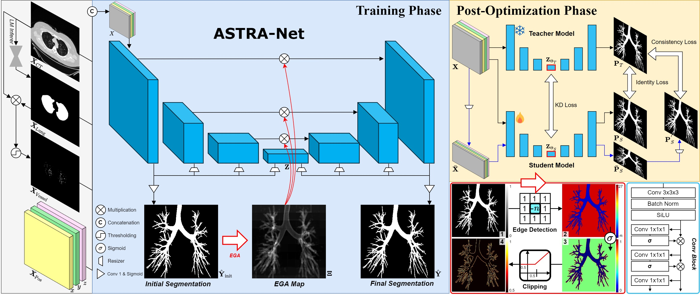
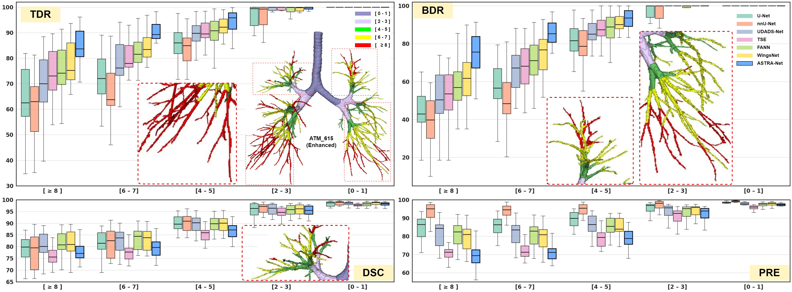
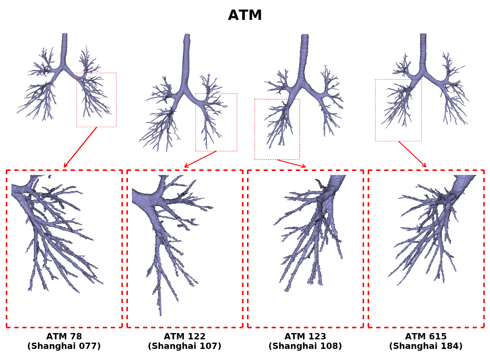

# ASTRA-Net v

**Discovery of Peripheral Airway Beyond Incomplete CT Annotations for Navigational Bronchoscopy**  
*IEEE Transactions on Medical Imaging*, 2026

ASTRA-Net is a framework for **3D airway segmentation** from chest CT in **Hounsfield units (HU)**. It combines CT intensity, lung and vessel context, and positional encoding to recover peripheral airways beyond incomplete annotations.

[**PyPI**](https://pypi.org/project/astra-airway/) · [**Checkpoints & Enhanced Labels**](https://github.com/guhong3648/ASTRA-Net/releases/tag/v0.3.0) · [**Standalone Demo**](src/Demo_inference_standalone_ver.ipynb) · [**pip Demo**](src/Demo_inference_pip_ver.ipynb)

---

### Architecture



*Overview of the ASTRA-Net architecture and its post-optimization framework.*

### Quantitative Results



*Comparison of airway segmentation accuracy and topological preservation across different methods.*

### Qualitative Results



*3D airway segmentation comparison across multiple methods, with enlarged views highlighting peripheral airway branches.*
  

---

> **Paper scope**
> - `src/src_T1/` — Binary airway segmentation (this paper)
> - `src/src_T2/` — Multi-class segmentation (**not part of this paper**)

## 1. Quick start
> **Docker Environment**
>
> ```bash
> docker pull guhong3648/guhong:v1
> ```


Install the inference package from [PyPI](https://pypi.org/project/astra-airway/):

```bash
pip install astra-airway          # Install only the core dependencies
pip install "astra-airway[demo]"  # Include additional libraries such as SimpleITK, matplotlib, etc...
```

Use any 3D chest CT in HU:

```python
import SimpleITK as sitk
from astra_infer import AWInferer

ct_image = sitk.ReadImage('chest_ct.mha')
CT = sitk.GetArrayFromImage(ct_image)

inferer = AWInferer(model_name='ASTRA-Net_Phase2')
output = inferer(CT)
AW = output['AW']

aw_image = sitk.GetImageFromArray(AW)
aw_image.CopyInformation(ct_image)
sitk.WriteImage(aw_image, 'AW.nii.gz')
```

- **Input:** 3D CT, `(Z, Y, X)`, HU
- **Output:** binary `uint8` mask aligned with the input CT
- **ASTRA-Net:** returns `AW`, `LM` (lung mask), and `CV` (vessel context)
- **Reference models:** return `AW` only

The selected checkpoint is **downloaded automatically** from [GitHub Releases](https://github.com/guhong3648/ASTRA-Net/releases/tag/v0.3.0) if missing  
The default pip checkpoint directory is `~/.cache/astra-airway/model/`

**Available models:** `ASTRA-Net_Phase2` (default), `ASTRA-Net_Phase1`, `UNet`, `FANN`, `UDADS-Net`, `WingsNet`  
**Defaults:** 64³ patches, overlap 32, batch 32, threshold 0.20, edge exclusion 65

**CUDA note:** PyTorch must be compatible with the NVIDIA driver  
If CUDA initialization fails, inference may fall back to CPU. See the [pip Demo](src/Demo_inference_pip_ver.ipynb) for a CUDA 11.8 installation example

## 2. Demos

| Notebook | Description |
|---|---|
| [Standalone Demo](src/Demo_inference_standalone_ver.ipynb) | Uses local `src/astra-airway/` without installing the package |
| [pip Demo](src/Demo_inference_pip_ver.ipynb) | Uses `pip install "astra-airway[demo]"` and the installed package |

Both demos include:

- Automatic download of the selected checkpoint and Enhanced annotations
- Three principal-plane projections and **16 axial slices** with green airway overlays (CT window: −600 / 1200 HU)
- **GT / Enhanced / Pred** comparison, including a zoomed view
- Saving predicted masks to `res/Demo_Output/`

Clone the repository, open either notebook from `src/`, and select a GPU in its first code cell  
The original CT must be obtained separately from the dataset provider. **GT is not required for inference**

```bash
git clone https://github.com/guhong3648/ASTRA-Net.git
cd ASTRA-Net/src
```

**Example case:** `ATM_615` (ATM26 Track 1) = `Shanghai_184` (Enhanced)  
For this case, the ATM22 Enhanced label is cropped at **Z = 147:737** to match the ATM26 CT ROI (verified against the original CT, MAE = 0 HU)

## 3. Data & preprocessing

- [ATM22](https://atm22.grand-challenge.org/) / [ATM26](https://atm26.grand-challenge.org/registration/): original CT and GT, obtained from the organizers
- [ASTRA-Net Release](https://github.com/guhong3648/ASTRA-Net/releases/tag/v0.3.0): six pretrained checkpoints and **20 Enhanced annotations**
- Case-info CSV files for preprocessing: **included in this repository**

The original CT and GT volumes are **not redistributed** here  
ATM26 is the main dataset for reproduction; ATM22 shares much of the same cohort but uses a different axial ROI

### Directory layout

```text
ASTRA-Net/
├── src/
│   ├── src_T1/                                 # Paper implementation
│   ├── src_T2/                                 # Reference only
│   ├── astra-airway/
│   │   └── model/                              # Standalone checkpoints
│   ├── Demo_inference_standalone_ver.ipynb
│   ├── Demo_inference_pip_ver.ipynb
│   └── preprocessing/
├── data/
│   ├── raw/
│   │   ├── ATM22_TrainBatch1/
│   │   │   └── TrainBatch1_CaseInfo.csv        # Case list for Preprocessing
│   │   ├── ATM22_TrainBatch2/
│   │   │   └── TrainBatch2_CaseInfo.csv        # Case list for Preprocessing
│   │   ├── ATM26_Track1/
│   │   │   ├── TrainBatch_CaseInfo.csv         # Case list for Preprocessing
│   │   │   ├── imagesTr/ATM_615_0000.mha       # Original CT (download separately)
│   │   │   └── labelsTr/ATM_615.mha            # Original GT (optional for Demo)
│   │   └── ATM26_Enhanced/
│   │       └── Shanghai_184_z_data.nii.gz-label.nrrd  # Same case as ATM_615
│   └── Dataset/                                # Preprocessed data
└── res/                                        # Results and Demo output
```

The demo notebooks download Enhanced NRRDs to `data/raw/ATM26_Enhanced/`  
Set `download_force = True` in the notebook to download and overwrite the Release assets again

### Preprocessing

Install the full research dependencies from the repository root:

```bash
pip install -r src/requirements.txt
pip install pynrrd pydicom
```

Run preprocessing **from `src/`**. Process ATM22 source data and ATM26 Track 1 **before** the Enhanced annotations:

```bash
tput rmam
cd src
python -u preprocessing/Data_Processing_ATM22_1.py --GPU_NUM 0 --idx_s 0 --idx_n 20
python -u preprocessing/Data_Processing_ATM22_2.py --GPU_NUM 0 --idx_s 0 --idx_n 20
python -u preprocessing/Data_Processing_ATM26_Track_1.py --GPU_NUM 0 --idx_s 0 --idx_n 20
python -u preprocessing/Data_Processing_ATM26_Enhanced.py --GPU_NUM 0 --idx_s 0 --idx_n 20
tput smam
```

These commands illustrate **20 cases per batch**, not the entire dataset. Increase `--idx_s` for subsequent batches  
Other scripts cover ATM22 validation, ATM22 Enhanced, ATM26 Track 2, BAS, and EXACT

idx_s: start of idx  
idx_n: number of idx (sample)

## 4. Training & evaluation

Paper implementation: **Track 1** (`src/src_T1/`)  
Phase 1 is trained first; Phase 2 uses the completed Phase 1 model

```bash
tput rmam
cd src
python -u src_T1/train.py --GPU_NUM 0 --name_dset Preset1 --name_model ASTRA_Net_phase_1 --epoch_load 0
python -u src_T1/train.py --GPU_NUM 0 --name_dset Preset1 --name_model ASTRA_Net_phase_2 --epoch_load 0
python -u src_T1/inference.py --GPU_NUM 0 --name_dset Preset1 --name_model ASTRA_Net_phase_2 --epoch_load -1
python -u src_T1/evaluation.py --name_dset Preset1 --name_model ASTRA_Net_phase_2 --epoch_load -1
tput smam
```

- [Training command notebook](src/Training_Shell_Script.ipynb): generate training and evaluation commands
- [Track 1 Evaluation](src/src_T1/Evaluation.ipynb): training curves and quantitative metrics
- [Track 2 Evaluation](src/src_T2/Evaluation.ipynb): anatomical labeling baseline results

**Track 2 is not a paper contribution**. It assigns anatomical classes within a fixed Track 1 airway mask and does not change the airway geometry  
It requires preprocessing with `Data_Processing_ATM26_Track_2.py` and a Track 1 Phase 2 checkpoint


## 5. Repository Structure

```text
ASTRA-Net/
├── README.md
├── src/
│   ├── astra-airway/                  # Pip inference package
│   ├── Demo_inference_standalone_ver.ipynb
│   ├── Demo_inference_pip_ver.ipynb
│   ├── Training_Shell_Script.ipynb
│   ├── src_T1/                        # ASTRA-Net (Track 1)
│   ├── src_T2/                        # Anatomical labeling (Track 2)
│   └── preprocessing/                 # Dataset preprocessing
├── data/
│   ├── raw/
│   │   ├── ATM22_TrainBatch1/
│   │   │   └── TrainBatch1_CaseInfo.csv
│   │   ├── ATM22_TrainBatch2/
│   │   │   └── TrainBatch2_CaseInfo.csv
│   │   └── ATM26_Track1/
│   │       └── TrainBatch_CaseInfo.csv
│   └── Dataset/                       # Preprocessed datasets
└── res/                               # Experiment results
```

**Note:** Track 2 is separate from the ASTRA-Net paper

## Citation

```bibtex
@article{lee_2026_ASTRA,
  title={Discovery of Peripheral Airway Beyond Incomplete CT Annotations for Navigational Bronchoscopy},
  author={Lee, SiYeoul and Seo, MinKyung and Kim, Jiye and Lee, Hyeyun and Seong, EonSeung and Lee, DongEon and Kim, Do Hyung and Jeong, Yeon Joo and Seol, Hee Yun and Kim, MinWoo},
  journal={IEEE Transactions on Medical Imaging},
  year={2026},
  doi={10.1109/TMI.2026.3672178}
}
```
